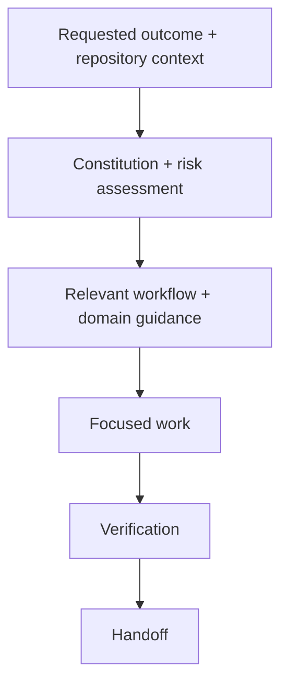

<div align="center">

# 🧭 Principal Engineer OS

[](https://hol.org/registry/plugins/yourakshaw%2Fprincipal-engineer-os)

**Principal-engineer judgment for AI-assisted software engineering.**

Build with explicit trade-offs, protect the boundaries that matter, and verify what you deliver.

[](SKILL.md)
[](LICENSE)
[](workflows/)
[](.github/CONTRIBUTING.md)

[Explore the skill](SKILL.md) · [Engineering constitution](references/constitution.md) · [Contribute](.github/CONTRIBUTING.md) · [Get help](.github/SUPPORT.md) · [Security](SECURITY.md)

</div>

---

## Engineering beyond the happy path

Working code is one part of the job. A retry can duplicate a payment. An authenticated request can still expose another tenant's data. A schema change can pass locally and break an older worker. A proposed rollback can become unsafe after data has changed.

**Principal Engineer OS (PEOS)** is an agent skill that brings those questions into design, implementation, review, and operations. It gives your agent a shared engineering constitution, focused workflows, domain references, and reusable decision artifacts to reason about correctness, security, reliability, and the cost of change.

Its guiding principle is simple:

> Deliver the smallest defensible solution that meets the requested outcome, protects its invariants, and remains affordable to operate and evolve.

That means a typo gets a focused edit. A payment integration gets scrutiny of idempotency, uncertain outcomes, reconciliation, and recovery. The process scales with the consequences of getting the change wrong.

## ⚙️ What the skill brings to your agent

| Capability | What it means in practice |
| :--- | :--- |
| **Defensible architecture** | Compare credible alternatives, make constraints explicit, and give complexity a concrete reason to exist. |
| **Correctness at boundaries** | Examine authorization, transactions, concurrency, retries, and partial failures where guarantees can break. |
| **Security and privacy** | Trace trusted identity, tenant scope, sensitive data, and untrusted input through the actual system. |
| **Operational judgment** | Connect changes to detection, capacity, rollout, recovery, and the people who operate them. |
| **Evidence-based delivery** | Separate inspected facts, executed checks, assumptions, and remaining uncertainty. |
| **Proportional effort** | Keep small work small; apply deeper analysis when data, privileges, compatibility, or recovery are at stake. |

PEOS supplies instructions and decision tools. Results still depend on the agent, available tools, repository context, and evidence; the package makes no benchmark or production-readiness guarantee.

## 🧩 How it works

The skill starts with the [engineering constitution](references/constitution.md), inspects the task and repository, and selects the relevant workflow. Domain guidance loads only when the changed boundaries need it.



The constitution sets priorities across correctness, security, user value, recoverability, maintainability, performance, and cost. It also preserves the distinction between a design, an implementation, a review, and an authorized operational action.

### Effort follows risk

| Tier | Typical work | Expected depth |
| :--- | :--- | :--- |
| **R0** | Comments, typos, documentation formatting | Contextual inspection and a focused diff |
| **R1** | Contained utility or noncritical UI change | Focused behavior and edge-case checks |
| **R2** | Endpoint, query, integration, worker | Boundary checks, failure analysis, compatibility |
| **R3** | Authentication, payments, sensitive data, races, migrations | Security and data analysis, recovery and rollout evidence |
| **R4** | Production deletion, irreversible migration, privilege architecture | Authorized sign-off, rehearsed recovery, staged execution |

A small diff can carry substantial risk. These tiers guide engineering effort; they do not grant permissions.

## Seven workflows, from first design to production recovery

| Workflow | Use it for | Expected deliverable |
| :--- | :--- | :--- |
| [System design](workflows/system-design.md) | New systems and consequential architecture choices | Boundaries, alternatives, failure model, and an incremental plan |
| [Repository bootstrap](workflows/repository-bootstrap.md) | New services, libraries, CLIs, and applications | A working vertical slice with a reproducible developer path |
| [Feature implementation](workflows/feature-implementation.md) | Features, fixes, integrations, and schema migrations | A focused behavioral change with verification and rollout considerations |
| [Code review](workflows/code-review.md) | Diff reviews, security assessments, and architecture audits | Prioritized findings with evidence and actionable fixes |
| [Refactor and debug](workflows/refactor-debug.md) | Diagnosis, behavior-preserving changes, and optimization | A supported diagnosis, preservation evidence, or measured improvement |
| [Production readiness](workflows/production-readiness.md) | Release assessments and operational handovers | A gate decision tied to a specific artifact and environment |
| [Incident response](workflows/incident-response.md) | Outages, degradation, and data-integrity incidents | Authorized stabilization, recovery evidence, and owned follow-ups |

## 📥 Get started

Choose the installation method for your environment. Keep [`SKILL.md`](SKILL.md), `references/`, `workflows/`, `assets/`, and `scripts/` together so the skill can resolve its supporting resources.

### Claude Code — clone and install

**Personal installation**, available across your local projects:

```sh
mkdir -p ~/.claude/skills
git clone https://github.com/YourAKShaw/principal-engineer-os.git ~/.claude/skills/principal-engineer-os
```

**Project installation**, scoped to one repository: run these commands from that project's root instead.

```sh
mkdir -p .claude/skills
git clone https://github.com/YourAKShaw/principal-engineer-os.git .claude/skills/principal-engineer-os
```

Already cloned the repository elsewhere? Copy its complete folder into either location as `principal-engineer-os`. The resulting entry point should be:

```text
~/.claude/skills/principal-engineer-os/SKILL.md
```

For a project installation, it should be `.claude/skills/principal-engineer-os/SKILL.md`. If sharing it through the parent project's version control, copy the package files without the clone's nested `.git` directory.

Start Claude Code in your working project, type `/`, and look for `principal-engineer-os`. Invoke it directly:

```text
/principal-engineer-os Review this repository's authorization boundaries and report evidence-backed findings.
```

Claude can also select it automatically for matching tasks. See the [Claude Code skills documentation](https://code.claude.com/docs/en/skills) for loading and scope details.

### Claude — download and upload a ZIP

1. [Download the repository ZIP](https://github.com/YourAKShaw/principal-engineer-os/archive/refs/heads/main.zip) and extract it.
2. Rename the extracted `principal-engineer-os-main` folder to `principal-engineer-os` so it matches the skill name.
3. Compress that folder into `principal-engineer-os.zip`. The archive must contain one top-level skill folder, with `SKILL.md` directly inside it:

   ```text
   principal-engineer-os.zip
   └── principal-engineer-os/
       ├── SKILL.md
       ├── references/
       ├── workflows/
       ├── assets/
       └── scripts/
   ```

4. In Claude, enable **Code execution and file creation** under **Settings → Capabilities**. Organization accounts also need Skills enabled by their administrator.
5. Open **Customize → Skills**, select **+ → Create skill → Upload a skill**, and upload your ZIP.
6. Toggle the skill on, then ask Claude to use Principal Engineer OS for your task.

A local clone can be packaged the same way; omit its `.git` directory. See Claude's [upload instructions](https://support.claude.com/en/articles/12512180-use-skills-in-claude) and [ZIP structure guide](https://support.claude.com/en/articles/12512198-how-to-create-custom-skills).

### Skills CLI — install for supported agents

With Node.js and npm available, run:

```sh
npx skills add YourAKShaw/principal-engineer-os
```

Follow the prompts to select your agent and installation scope. The package name is **`skills`**, plural.

To target Claude Code explicitly, run this from your project's root:

```sh
npx skills add YourAKShaw/principal-engineer-os --agent claude-code
```

For a personal installation across projects:

```sh
npx skills add YourAKShaw/principal-engineer-os --agent claude-code --global
```

You can also install from an existing local clone:

```sh
npx skills add ./principal-engineer-os
```

See the [Skills CLI documentation](https://github.com/vercel-labs/skills#readme) for supported agents and installation options.

### Check the package

Optionally validate a Claude Code personal installation:

```sh
python3 ~/.claude/skills/principal-engineer-os/scripts/validate-skill.py
```

Python 3.9+ is required for this offline structural check. A passing result confirms package integrity; confirm activation separately in your chosen host. Installation commands above follow the linked host and CLI documentation; they have not been exercised across hosts in this repository.

## 💬 Put it to work

Name the skill and describe the outcome, constraints, and scope of work you want:

**Design a system**

> Use Principal Engineer OS to design a multi-tenant document service. Compare a modular monolith with separate services, explain tenant isolation and failure behavior, and propose an incremental implementation plan. Design only.

**Implement a consequential integration**

> Use Principal Engineer OS to add payment retries to this checkout flow. Inspect the existing code first. Handle a provider timeout after a successful charge, preserve compatibility, and verify duplicate-request behavior.

**Review a risky boundary**

> Use Principal Engineer OS to review this PR for tenant isolation and migration safety. Report prioritized findings with concrete triggers and evidence.

**Assess a release**

> Use Principal Engineer OS to assess this release for production readiness. Tie the assessment to the artifact and environment, identify missing evidence, and prepare rollout and recovery steps.

These illustrate the analysis the skill asks for. They are not claims of evaluated agent performance. For a small task, a direct request such as “Use Principal Engineer OS to fix this validation bug” is enough; the skill is designed to scale down.

## Domain guidance, loaded when needed

| Domain | Coverage |
| :--- | :--- |
| [Principles and patterns](references/principles-and-patterns.md) | Invariants, abstraction, coupling, and the cost of complexity |
| [Architecture and distributed systems](references/architecture-and-distributed-systems.md) | Service boundaries, consistency, queues, caches, and capacity |
| [APIs and data](references/apis-and-data.md) | Contracts, transactions, concurrency, migrations, and retention |
| [Security and privacy](references/security-and-privacy.md) | Identity, authorization, tenant isolation, secrets, and supply chain |
| [Reliability, observability, performance](references/reliability-observability-performance.md) | SLOs, recovery, telemetry, saturation, and measurement |
| [Testing, quality, delivery](references/testing-quality-and-delivery.md) | Meaningful tests, reproducibility, dependencies, and release safety |
| [Frontend and language overlays](references/frontend-and-language-overlays.md) | Stack-specific hazards, browser state, accessibility, and mobile |
| [AI agent engineering](references/ai-agent-engineering.md) | LLMs, RAG, tool permissions, evaluations, and prompt injection |

### Reusable engineering artifacts

- **[Architecture decision record](assets/adr-template.md):** capture a consequential choice, alternatives, evidence, and revisit triggers.
- **[System design RFC](assets/system-design-rfc.md):** make requirements, boundaries, failure behavior, and implementation milestones reviewable.
- **[Production release gate](assets/production-gate.md):** connect a release decision to executed checks, recovery evidence, and unresolved risks.

Use these where they help the deliverable. Small changes do not need a document set.

## 📂 Inside the repository

```text
principal-engineer-os/
├── SKILL.md          # Entry point and routing
├── references/       # Shared constitution and eight domain guides
├── workflows/        # Seven outcome-oriented engineering workflows
├── assets/           # ADR, system design RFC, and production gate
├── scripts/          # Package validator, wrappers, and regression suite
├── .github/          # Contributing guide, support, and issue/PR templates
├── README.md         # Project overview
├── SECURITY.md       # Vulnerability reporting policy
└── LICENSE           # MIT License
```

The package is adapted from *Principal Engineer OS — Master Engineering Constitution*, edition 1.0, 14 October 2026. The packaged constitution is the shared policy; historical `raw/` material is not an installation dependency.

## Validate the package

From the repository root:

```sh
python3 scripts/validate-skill.py
```

The validator uses the Python 3.9+ standard library to check the manifest, required resources, local Markdown links and anchors, resource reachability, and empty or unfinished package files. It runs offline, installs nothing, and does not execute project code.

It checks package integrity. Engineering quality, agent behavior, external link currency, and host-specific installation support require separate evaluation. See [contributing](.github/CONTRIBUTING.md) for wrapper commands and validator regression checks.

---

## 🤝 Contributing and support

Improvements are welcome, especially concrete failure cases, clearer decision guidance, and stronger verification examples. Start with the [contribution guide](.github/CONTRIBUTING.md), use the [issue forms](https://github.com/YourAKShaw/principal-engineer-os/issues/new/choose), or read the [support guide](.github/SUPPORT.md) for usage questions. Report vulnerabilities privately as described in the [security policy](SECURITY.md), not in a public issue.

## License

Distributed under the **MIT License**. See [LICENSE](LICENSE) for details.
